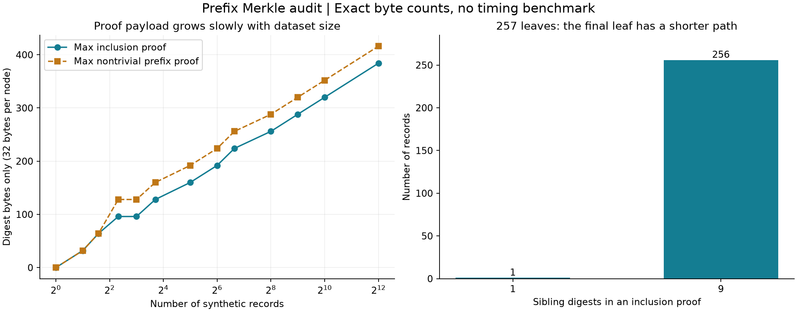

# Prefix Merkle audit

A small, runnable data-engineering project for **ordered dataset commitments**:
verify a record at a given position, then verify that a later snapshot preserves
an earlier snapshot as its prefix. The verifier needs saved tree heads and short
proofs, rather than every record in both snapshots.

The original implementation demonstrates bounded ingestion, deterministic
serialization, hashing, proof validation, and independent reference tests.
Merkle trees are an established method; this project does not introduce a new
cryptographic construction. All included records are **deterministic synthetic
data** generated by `examples/demo.py`. No external or personal data are used.

**Trust the saved heads separately.** A root hash is not a signature, and a
self-consistent replacement dataset can produce its own valid proofs. The
example makes this distinction executable rather than claiming that a hash
alone establishes a trustworthy source.



## Reproduce

Python 3.11 and 3.13 are tested in GitHub Actions. The library and CLI use only
the standard library. The pinned requirements supply pytest and Matplotlib
with its dependencies for testing and the figure.

```bash
python3 -m venv .venv
source .venv/bin/activate
python -m pip install -r requirements.txt
python -m pip install --no-deps .
python -m pip check
python -m pytest -q
python examples/demo.py --output results

merkle-audit verify-inclusion \
  --head results/new-head.json \
  --record results/record.json \
  --proof results/inclusion.json

merkle-audit verify-consistency \
  --old-head results/old-head.json \
  --new-head results/new-head.json \
  --proof results/consistency.json
```

Both checks print `{"verified": true}`. The demo writes two JSONL snapshots
(128 and 257 records), their heads, a record at index 17, both proofs, a metrics
file, and the plot. Repeated runs produce identical JSON/JSONL artifacts. Figure
rendering can vary across environments. There is no random sampling or timing
benchmark.

To generate artifacts from the included dataset:

```bash
merkle-audit head results/new.jsonl
merkle-audit inclusion results/new.jsonl --index 17
merkle-audit consistency results/new.jsonl --old-size 128
```

Creation commands print JSON to standard output. Verification requires heads
as separate arguments; it does not accept an asserted root embedded in a proof
as a trust anchor. Exit codes are 0 for success, 1 for a well-formed but failed
verification, and 2 for malformed input or an operational error.

## API example

```python
from prefix_merkle import (
    MerkleTree, encode_record, verify_inclusion, verify_consistency,
)

rows = [{"id": i, "value": 7 * i} for i in range(9)]
tree = MerkleTree(encode_record(row) for row in rows)
saved = tree.prefix_head(5)

assert verify_inclusion(encode_record(rows[3]), 3, tree.head, tree.inclusion(3))
assert verify_consistency(saved, tree.head, tree.consistency(5))
assert not verify_inclusion(
    encode_record({"id": 3, "value": 999}), 3, tree.head, tree.inclusion(3)
)
```

The core `MerkleTree` accepts arbitrary bounded byte leaves; the JSONL CLI
always uses the record encoding below. `TreeHead` is an immutable size/root
pair. For a real audit, retain the old head independently before obtaining the
new snapshot or proof. Creating both heads from whatever data are currently
offered does not establish historical continuity.

## Record and artifact contract

The application format is `prefix-merkle-sha256-v1`, with encoding
`flat-json-v1`. This is a restricted application encoding, **not general
canonical JSON or RFC 8785**.

- One record is an object with 1--32 fields. Keys are ASCII identifiers matching
  `[A-Za-z_][A-Za-z_0-9]{0,63}`.
- Values are null, booleans, signed 64-bit integers, or Unicode strings. Floats,
  arrays, and nested objects are rejected. A string is at most 4096 UTF-8 bytes;
  unpaired surrogates are rejected.
- Encode with UTF-8, keys sorted lexicographically, no insignificant whitespace,
  no ASCII-only escaping, and ordinary JSON string escaping. Python's
  `json.dumps(..., ensure_ascii=False, sort_keys=True, separators=(',', ':'))`
  defines the byte representation for these restricted values. An encoded
  record may not exceed 16 KiB.
- Source JSON must be UTF-8 and may vary in field order, whitespace, and valid
  string escape spelling. Duplicate keys and non-finite numbers are rejected.
  Unicode normalization is **not** applied: composed and decomposed strings
  remain distinct. Integer `1`, string `"1"`, and boolean `true` are distinct.
  Cross-language readers must preserve int64 values exactly.
- JSONL record order and duplicates are preserved. IDs have no special meaning;
  uniqueness, increasing timestamps, and schema consistency across records
  are not enforced. Blank lines are rejected; an empty file is an empty tree.
- Heads and proofs have exact field sets, format/encoding tags, bounded integer
  positions/sizes, and lowercase 64-character digest strings. Unknown fields,
  mismatched proof metadata, extra siblings, and truncated proofs fail.

The source JSONL limit is 8 MiB, at most 4096 rows, and at most 16,385 bytes
per physical line including any newline. The raw-byte tree also caps total
leaf payload at 8 MiB. A head document is capped at 4 KiB; proof and standalone
record documents at 16 KiB. These limits bound local work, not every possible
resource-use concern of a public service.

## Tree and proof method

The tree shape and proof definitions follow
[RFC 9162, Section 2.1](https://www.rfc-editor.org/rfc/rfc9162.html#section-2.1).
Empty trees hash the empty byte string. Leaves hash `0x00 || payload`; internal
nodes hash `0x01 || left_digest || right_digest`, using SHA-256. For a subtree
of size `n > 1`, split at the largest power of two strictly below `n`. No final
leaf is duplicated to fill a level.

Inclusion verification derives sibling orientation from the index and tree
size and consumes exactly the required path. Consistency verification rebuilds
both old and new roots from shared subtree commitments. For equal sizes, it
requires equal roots and an empty proof. An empty old tree is a vacuous prefix
and requires an empty proof; it says nothing about nonempty contents. These
claims rely on the hash's collision resistance. This repository implements
neither Certificate Transparency wire messages nor its signing protocol.

Proof generation uses a recursive interval tree with cached subtree hashes.
Initial construction hashes each leaf and internal node once and retains all
leaf payloads. Each generated proof and verification uses logarithmically many
digests. Querying additional prefix heads can add cached interval roots; the
cache is retained for the life of the tree. This is an in-memory reference
implementation, not a streaming or persistent append service.

## Synthetic findings

The generated [metrics](results/metrics.json) contain actual validation results
and exact byte counts. The main snapshot has 257 leaves. A proof for index 17
uses nine sibling digests (288 raw bytes); the 128-to-257 prefix proof uses two
(64 raw bytes). With metadata, hex encoding, indentation and final newline,
the written proof files are respectively 793 and 295 bytes.

At 4096 records, the generated canonical JSONL occupies 273,587 bytes. Each
inclusion proof has 384 digest bytes, and the largest nontrivial prefix proof
has 416 digest bytes. These counts **exclude** head files, the record being
verified, and JSON framing. They do not measure total storage or wall time.
For the 257-leaf tree, 256 positions have nine siblings while the final leaf
has only one; proof lengths depend on the tree shape and position.

| Check in the deterministic example | Accepted? | What it demonstrates |
| --- | --- | --- |
| Original record against saved new head | Yes | Valid positional inclusion |
| Original 128-record prefix extended to 257 | Yes | Valid ordered-prefix relation |
| Modified record against original head | No | Original commitment detects this change |
| Modified or reordered prefix against saved old head | No | Existing records cannot be rewritten under the tested commitments |
| Extra consistency-proof node | No | Unused proof material is rejected |
| Modified record against its substituted new head | Yes | A consistent hash does not authenticate the head |
| Duplicate ID appended in the suffix | Yes | Prefix consistency is not a uniqueness contract |

An inclusion proof also does not establish dataset completeness. A publisher
can commit to a selected subset and prove membership within that subset. There
is no protection here against omitted observations before the initial head,
inaccurate records, backdated suffix records, or separate inconsistent histories
shown to different readers. The project has no signatures, external timestamping,
access control, gossip, or secure head distribution. Hashing is not encryption.

## Validation

The 59 tests include:

- Independent tree roots built with a binary-carry frontier rather than the
  production recursive split, plus directly assembled small tree shapes.
- Every inclusion and every prefix for 18 sizes spanning empty, singleton,
  power-of-two and irregular trees; a separate bottom-up consistency verifier
  checks the recursively generated proofs.
- One-bit changes to each consistency proof node, missing/extra nodes, changed
  records, reordered prefixes, wrong indexes/sizes, and empty/equal-size cases.
- Duplicate leaves, omission/substitution boundaries, the maximum supported
  tree size, resource limits, published encoding bytes, Unicode/type distinctions,
  duplicate JSON keys, strict metadata, and complete installed-CLI round trips
  from outside the source directory.

The full example additionally verifies every inclusion and nontrivial prefix
for its 13 plotted tree sizes through 4096 leaves. Tests are executable checks,
not a security audit or a proof of the hash function's cryptographic properties.
Code and synthetic examples were written for this project; the method reference
is credited above. MIT licensed; see [LICENSE](LICENSE).
